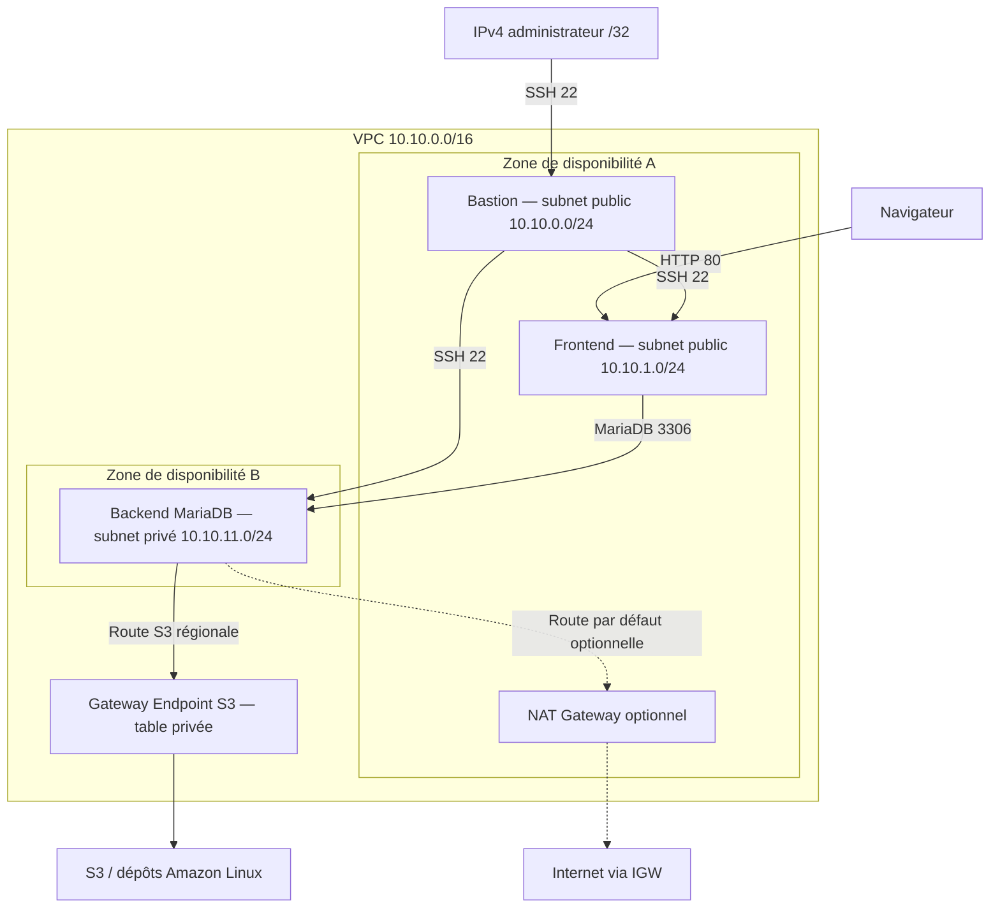

# Laboratoire réseau AWS & CloudFormation

[Français](README.fr.md) | [English](README.md)

Déployez un réseau AWS à trois instances avec l'Infrastructure as Code, puis configurez un serveur MariaDB privé avec Bash. Ce laboratoire permet de pratiquer le routage VPC, les groupes de sécurité, SSH via un bastion, une passerelle NAT optionnelle et l'accès privé aux dépôts Amazon Linux hébergés dans S3.

**Périmètre : étapes 01 à 07.** CloudFormation provisionne le réseau et les EC2. Le script MariaDB est transféré et lancé manuellement par SSH. Systems Manager et le déploiement CI/CD restent des évolutions futures.

## Commencer

La version actuelle du laboratoire se trouve sur **`develop`**. Jusqu'à la promotion d'une version relue vers `main`, utilisez :

```bash
git clone --branch develop https://github.com/rachadk1/aws-networking-cloudformation-lab.git
cd aws-networking-cloudformation-lab
```

Les guides de reproduction sont disponibles en français et en anglais. Utilisez votre propre compte AWS, une Key Pair de la région choisie et votre IPv4 publique d'administration.

1. [Installer AWS CLI v2 sur votre ordinateur](docs/aws-cli-installation.md)
2. [Prérequis et coûts](docs/prerequisites.md)
3. [Architecture et sept étapes pédagogiques](docs/architecture.md)
4. [Déploiement, SSH et installation MariaDB](docs/deployment-guide.md)
5. [Validation et dépannage](docs/validation-tests.md)
6. [Sauvegarde et nettoyage](docs/cleanup.md)

## Architecture



Le schéma présente les flux autorisés. Le frontend sert une page Apache statique ; la connexion à la base est testée avec un client MariaDB. Le trafic Internet des subnets publics passe par l'Internet Gateway, omis des flèches d'entrée publiques pour alléger le schéma.

## Ressources provisionnées

| Composant | Implémentation |
| --- | --- |
| VPC | `10.10.0.0/16`, résolution DNS et noms d'hôte activés |
| Subnets | Deux subnets publics dans une AZ ; un subnet privé dans une seconde AZ |
| Routage | Route publique par défaut vers l'IGW ; route privée S3 ; route par défaut NAT optionnelle |
| Groupes de sécurité | Administrateur → bastion SSH ; bastion → frontend/backend SSH ; HTTP public → frontend ; SG frontend → backend TCP 3306 |
| EC2 | Trois instances optionnelles Amazon Linux 2023 `t3.micro` ; IMDSv2 obligatoire |
| Frontend | Apache installé par le UserData EC2 |
| Backend | MariaDB initialisé par `scripts/setup-mariadb.sh` |

`LaunchEc2Instances` et `EnableNatGateway` valent tous deux `false` par défaut. Le parcours complet active explicitement les EC2 et laisse NAT désactivé. Le point de terminaison S3 est toujours provisionné.

## Versions linguistiques

| Contenu | Français | English |
| --- | --- | --- |
| Présentation du projet | [README](README.fr.md) | [Overview](README.md) |
| Installation AWS CLI | [Guide](docs/aws-cli-installation.md) | [Guide](docs/en/aws-cli-installation.md) |
| Prérequis et coûts | [Guide](docs/prerequisites.md) | [Guide](docs/en/prerequisites.md) |
| Architecture et étapes | [Guide](docs/architecture.md) | [Guide](docs/en/architecture.md) |
| Déploiement et SSH | [Guide](docs/deployment-guide.md) | [Guide](docs/en/deployment-guide.md) |
| Validation et dépannage | [Guide](docs/validation-tests.md) | [Guide](docs/en/validation-tests.md) |
| Sauvegarde et nettoyage | [Guide](docs/cleanup.md) | [Guide](docs/en/cleanup.md) |

Les commentaires et descriptions CloudFormation, la page de démonstration, les commentaires et messages du script, et les commentaires du `.gitignore` comprennent les deux langues. Les identifiants de ressources, tags, chemins, options CLI et noms SQL restent stables pour préserver la compatibilité des commandes. Mettez les deux versions à jour ensemble lors d'une modification d'un guide. Les anciennes branches d'étape conservent des instantanés historiques ; utilisez `develop` pour le laboratoire bilingue actuel.

## Contenu du dépôt

- `cloudformation/network-lab.yaml` — template d'infrastructure.
- `scripts/setup-mariadb.sh` — configuration MariaDB et permissions applicatives.
- `docs/` — guides français de reproduction, validation et nettoyage.
- `docs/en/` — versions anglaises complètes des guides.
- `README.md` — présentation du projet en anglais.
- `.gitignore` — exclusions de fichiers locaux d'identifiants, paramètres et sauvegardes SQL.

## Limites pédagogiques

Cette architecture de laboratoire ne comprend pas de load balancer, site TLS, réplication de base, sauvegardes automatiques, IAM Instance Profile, configuration SSM ou workflow de déploiement. Deux AZ ne rendent pas le backend unique hautement disponible. Le trafic sortant des SG utilise les valeurs par défaut d'AWS ; le point de terminaison S3 utilise sa politique par défaut.

Les ressources AWS peuvent être facturées : EC2, EBS, IPv4 publiques et NAT optionnel. Aucun tarif fixe ni droit au Free Tier n'est présumé. Lisez les coûts avant de déployer et nettoyez les ressources ensuite. Le template ne définit aucune politique de rétention ou de sauvegarde de la base : supprimer la stack ou désactiver les EC2 peut détruire la base.

## Collaborer

Créez vos changements dans une branche puis ouvrez une PR vers `develop`. La relecture et la fusion sont des étapes distinctes. Ne versionnez pas de clé privée, identifiant AWS, fichier local de paramètres, mot de passe SQL ou dump de base. Le `.gitignore` ne retire pas les secrets déjà suivis par Git.
