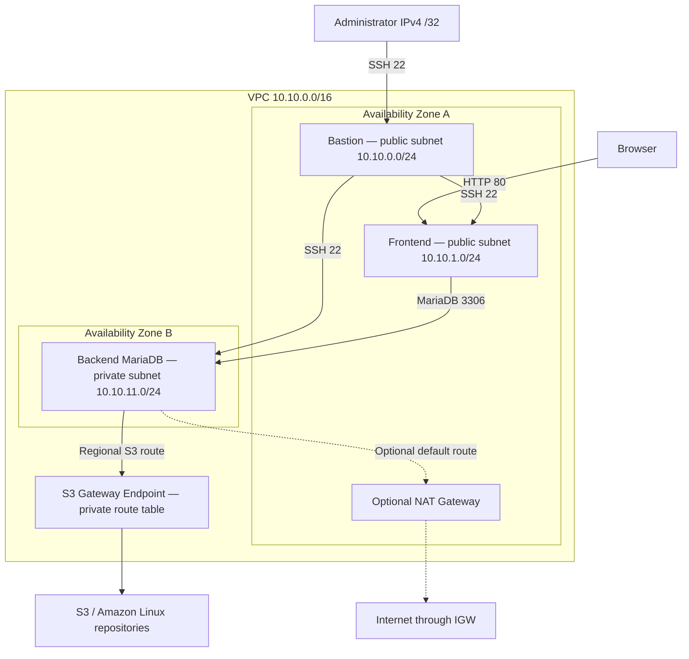

# AWS Networking & CloudFormation Lab

Build a three-instance AWS network with Infrastructure as Code, then configure a private MariaDB server with Bash. Practice VPC routing, security groups, SSH through a bastion, an optional NAT Gateway, and private access to S3-backed Amazon Linux repositories.

**Scope: steps 01–07.** CloudFormation provisions the network and EC2 instances. The MariaDB script is copied and run manually over SSH. Systems Manager and CI/CD deployment are future work.

## Start here

The current lab baseline is on **`develop`**. Until a reviewed release is promoted to `main`, use:

```bash
git clone --branch develop https://github.com/rachadk1/aws-networking-cloudformation-lab.git
cd aws-networking-cloudformation-lab
```

The reproduction guides are in French. Use your own AWS account, regional EC2 key pair, and administrator IPv4 address.

1. [Prerequisites and costs](docs/prerequisites.md)
2. [Architecture and seven learning steps](docs/architecture.md)
3. [Deployment, SSH and MariaDB setup](docs/deployment-guide.md)
4. [Validation and troubleshooting](docs/validation-tests.md)
5. [Backup and cleanup](docs/cleanup.md)

## Architecture



The diagram shows permitted paths. The frontend serves a static Apache page; database connectivity is tested with a MariaDB client. Public subnet internet traffic uses the Internet Gateway, omitted from the diagram's public ingress paths for readability.

## What is provisioned

| Component | Implementation |
| --- | --- |
| VPC | `10.10.0.0/16`, DNS support and hostnames enabled |
| Subnets | Two public subnets in one AZ; one private subnet in a second AZ |
| Routing | Public default route to IGW; private S3 endpoint route; optional NAT default route |
| Security groups | Administrator → bastion SSH; bastion → frontend/backend SSH; public HTTP → frontend; frontend SG → backend TCP 3306 |
| EC2 | Three optional `t3.micro` Amazon Linux 2023 instances; IMDSv2 required |
| Frontend | Apache installed through EC2 UserData |
| Backend | MariaDB initialized by `scripts/setup-mariadb.sh` |

`LaunchEc2Instances` and `EnableNatGateway` both default to `false`. The full walkthrough explicitly enables EC2 and leaves NAT disabled. The S3 endpoint is always provisioned.

## Repository

- `cloudformation/network-lab.yaml` — infrastructure template.
- `scripts/setup-mariadb.sh` — MariaDB setup and application grants.
- `docs/` — reproduction, validation and cleanup guides.
- `.gitignore` — common local credentials, parameters and database dumps.

## Learning boundaries

This is a lab architecture: no load balancer, TLS website, database replication, automated backups, IAM instance profile, SSM configuration, or deployment workflow is included. Two AZs do not make the single database highly available. Outbound security-group traffic uses AWS defaults; the S3 endpoint has the default endpoint policy.

AWS resources can incur charges, including EC2, EBS, public IPv4 and optional NAT. No fixed price or Free Tier eligibility is assumed. Read the cost notes before deployment and clean up afterward. The template has no database retention or backup policy: deleting the stack or disabling EC2 can destroy the database.

## Collaboration

Create changes in a branch and open a PR targeting `develop`. Review and merge separately. Do not commit private keys, AWS credentials, local parameter files, database passwords or SQL dumps. A `.gitignore` does not remove secrets already tracked in Git.
